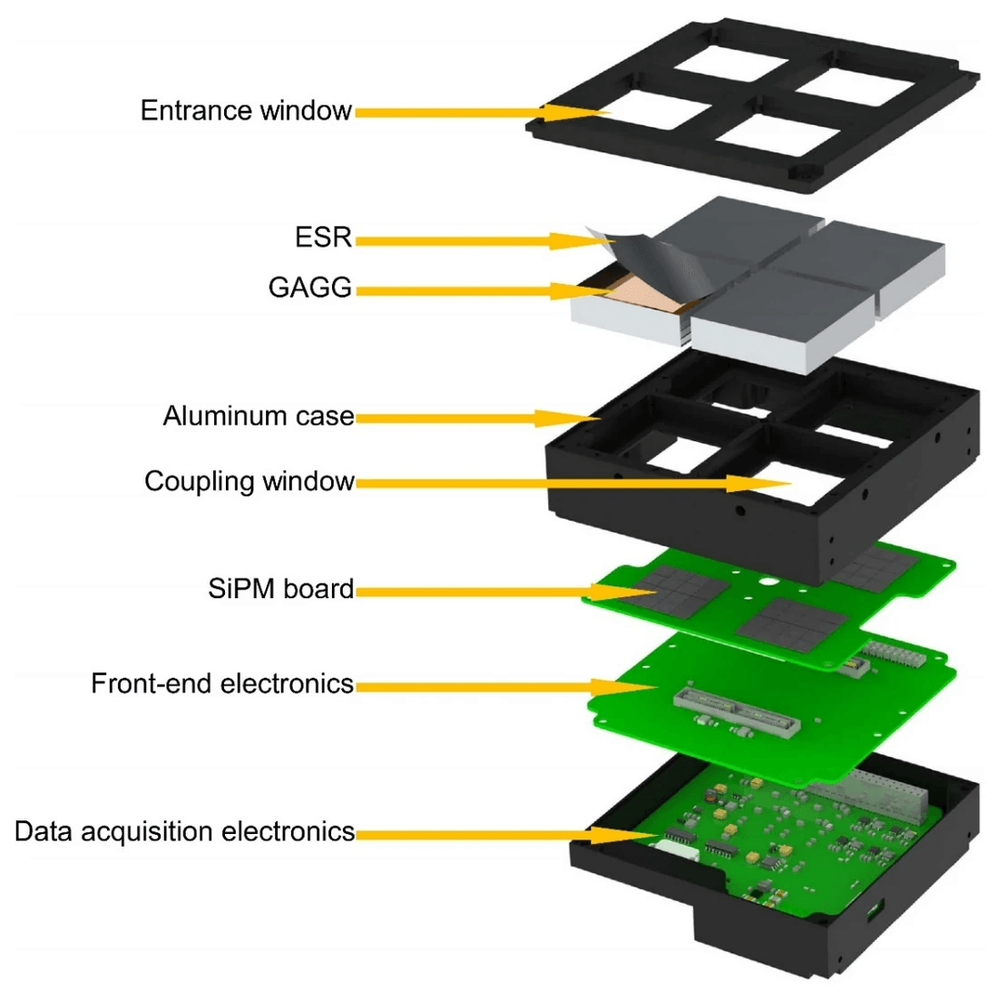
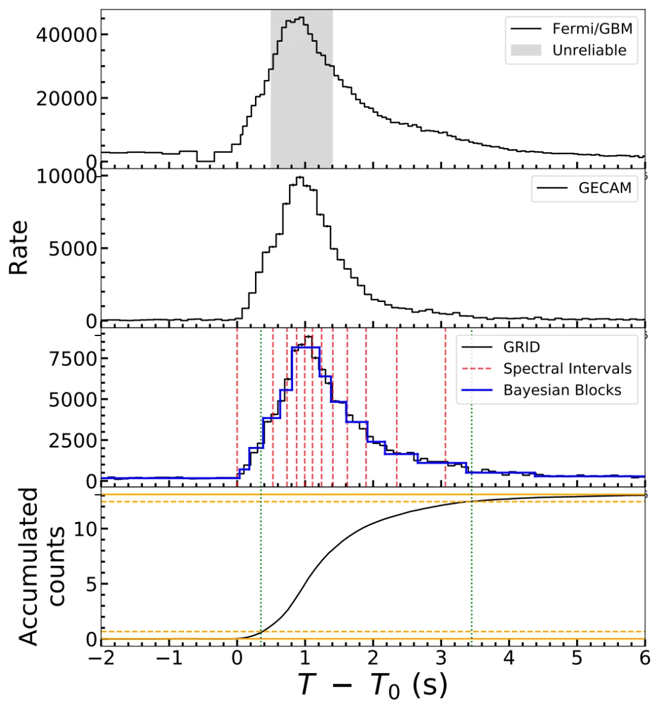
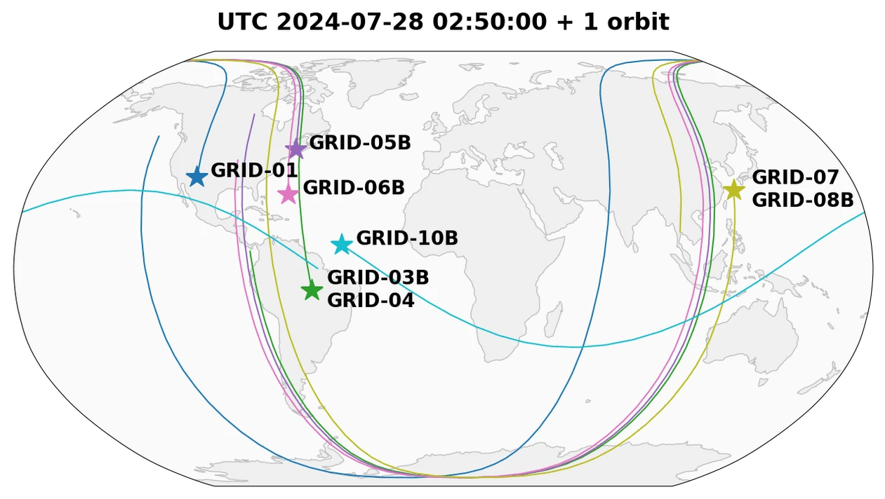
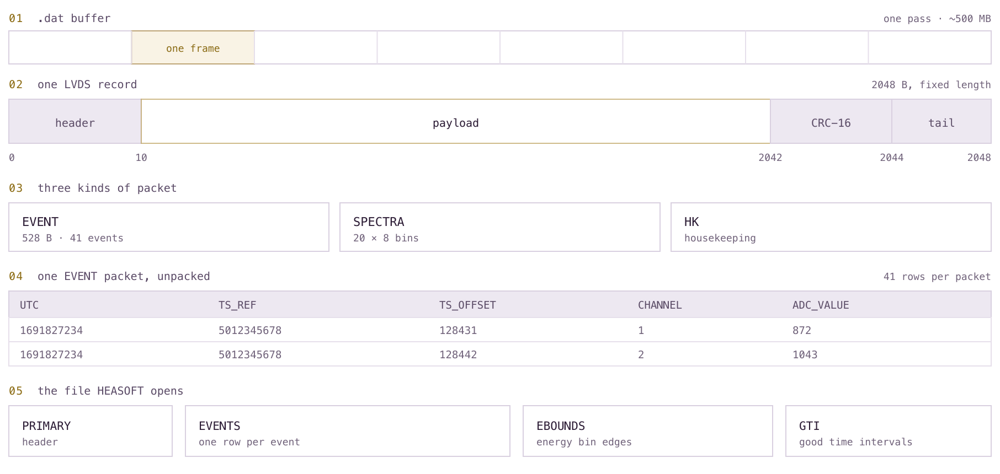
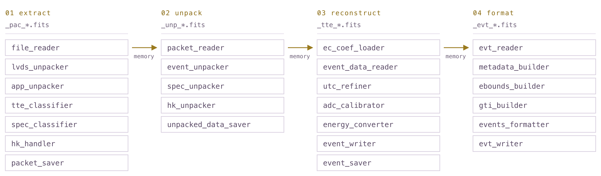

From 2024 to 2026, the Tsinghua University Student Cluster Competition Team worked with the [GRID collaboration](https://grid.tsinghua.edu.cn/site/) on satellite telemetry preprocessing. GRID observes transient gamma-ray sources, whose afterglows require timely follow-up. Its original four serial Python scripts exchanged data through disk files, delaying the conversion of downlinked telemetry into scientific event products.

## Scientific background: gamma-ray bursts

Gamma-ray bursts were discovered in 1967: the Vela satellites, launched to monitor nuclear tests, recorded gamma-ray flashes from the cosmos. One to three bursts arrive at Earth every day, lasting from milliseconds to several minutes; the brightest release in a few seconds the energy equivalent to the Sun's total output over its lifetime. Nearly sixty years later, the general properties of these bursts are clear, but the radiation mechanism is still under study.

The possibility of associating GRBs with other messengers was established by GW 170817: a binary neutron-star merger, first observed by gravitational-wave detectors, whose gamma-ray counterpart arrived 1.7 s later and was recorded by a small satellite pointed at that sky region by chance. Detecting such coincidences at a usable rate requires three conditions simultaneously: sky coverage large enough, localization accuracy sufficient to guide follow-up telescopes, and observation duration long enough not to miss short bursts. A network of small satellites can provide all three at relatively low cost, this is the basic idea behind GRID.

The GRID program (Gamma Ray Integrated Detectors) began in 2016 as a student project at Tsinghua University. The payload occupies 0.5 U, reads out a GAGG:Ce scintillator with an SiPM array, and covers the energy range 10 keV to 2 MeV. As of August 2026, thirteen payloads had been placed in orbit aboard CubeSats developed by several universities. The collaboration has published GRB 210121A, GRID's first scientific result; GRB 230703A was the first burst GRID led the localization of, using GRID-03B's Earth-occultation geometry to rule out Cygnus X-1; GRB 230812B was the third-brightest burst in history, and GRID-05B provided the only unsaturated observation of this event.

*Figure 1. Exploded view of the payload, from the entrance window and GAGG:Ce crystal, through the SiPM board, to the front-end and acquisition electronics, stacked into 0.5 U.*

*Figure 2. GRB 230812B recorded simultaneously by Fermi/GBM, GECAM, and GRID; the third panel is GRID's data, also the only unsaturated observation of this third-brightest burst in history.*

GRID 2.0 aims to become an instrument, not just a verification effort: ten to twenty satellites, a MeV Compton telescope covering the band left open after COMPTEL, with an expected detection of more than 160 bursts per year.

## Preprocessing in the GRID observation pipeline

An observation goes through four steps before reaching the scientists; this collaboration topic addresses the second step.

1. Downlink. The satellite stores its observations and downlinks them all at once during a pass, producing one .dat file of several hundred megabytes per pass.
2. Pre-processing. Raw telemetry is converted into standard scientific event files: frame cutting, verification, unpacking, energy calibration, and writing headers and extensions. These data themselves can be openly released for astronomers worldwide to conduct follow-up scientific analysis. This is the stage discussed in this article.
3. Scientific analysis. Using HEASOFT, XSPEC, and the collaboration's own tools for light curves, spectra, localization, and spectral fitting.
4. Public release. Issuing a GCN Circular for other observatories to follow up.

*Figure 3. Ground tracks of eight of the thirteen in-orbit payloads over one orbit, 28 July 2024. Each track corresponds to a pass that will produce a file; the order of these passes does not reflect scientific priority.*

## The original pipeline: four stages and four products

In the original implementation, this stage consisted of four programs run in sequence, each writing a FITS file for the next to read.

1. Frame cutting. Search the .dat buffer for LVDS frames, the physical-layer encapsulation emitted by the payload electronics. Each candidate frame is checked against its header, tail, and CRC-16; passing frames are stripped to the application layer and sorted by frame type: time-tagged events, spectra, and housekeeping.
2. Unpacking. Each packet is a fixed-length binary record with bit-level fields spanning bytes. Unpacking turns them into columns: UTC seconds, timestamp offset, channel number, ADC value.
3. Event reconstruction. Calibration happens here. The timestamp is refined to sub-second precision (about 12 ns) by dividing the scale offset by the crystal-oscillator frequency 99,998,665 Hz. ADC values are corrected per channel using temperature and bias calibration, then converted to energy with a piecewise quadratic polynomial, switching segments at 50.2 keV to match the detector's nonlinearity. Events are regrouped by channel.
4. Formatting. The results are packaged into astronomical products: standard headers, an EBOUNDS extension giving energy boundaries, a GTI extension giving good time intervals, a PI column binned by energy, 4 μs dead time per event, and an event-type flag. The output is the file HEASOFT can open.

*Figure 4. Data structures across the four processing stages. Records are located by a sync word rather than a fixed offset, the very reason the original implementation scanned the whole buffer with a regular expression; afterward every field's position is fixed. The two main rewrites in row 04 target the same step: turning 41 fixed offsets into five columns, completed for all packets at once.*

The first three stages each write an intermediate product read by the next stage. On the GRID-11B test data file, the four stages total 467.3 s: frame cutting 31.4 s, unpacking 194.0 s, reconstruction 224.4 s, formatting 17.5 s. Reconstruction dominates, and is the only stage doing arithmetic per event, yet most of its 224.4 s is spent assembling output arrays rather than computing; the 194.0 s of unpacking is mostly spent fetching fields one struct at a time.

Most of this time comes from four physics-independent inefficiencies: a regular expression scanning the whole buffer although frame positions are predictable; every packet going through a Python-layer struct.unpack loop; every vectorized result being converted to a Python list and back; and every stage boundary writing a full file and reading it back again.

*Figure 5. The four stages merged into one workflow. Node names match the code; the three golden arrows are bridge nodes, which replace the "write a FITS, then read it back" pattern with direct computation and asynchronous I/O.*

## What we built

The pre-processing reimplementation proceeds in two layers: first port the original scripts onto the workflow framework so the data link becomes an observable, automatically parallelizable workflow; then rewrite the record-by-record processing logic inside the workflow nodes through the framework's primitive interfaces, with the framework providing an efficient concurrent implementation.

### A workflow framework for parallel execution

The original pre-processing scripts consisted of multiple scripts that exchanged intermediate data through the filesystem, which is inefficient. We reorganized the entire link into a workflow graph: each stage is a node, and the data dependencies between nodes are expressed explicitly through typed edges. The framework manages data flow and concurrency: pipeline parallelism, batch accumulation, continuous flow, and fan-out between stages are all declared through the edges' transmission semantics. This means that when data volume grows or latency requirements tighten, the concurrency strategy is a configuration item of the framework, without requiring developers to manually optimize parallel data-processing logic. The data unit passed between nodes can be a number, an array, or any Python object. For example, nodes can pass a dictionary holding numpy arrays directly, without serializing it into an array before passing.

The framework provides multiple execution modes to run the same graph, including fully sequential (for debugging and comparison), pipeline parallel (adjacent stages overlap execution), and producer-consumer backpressure, and the developer chooses the appropriate mode. After each run, the framework's built-in performance monitor records and outputs per-node timing, making the cost and distribution of each link in the data chain visible; this is also the observability convenience brought by the workflow framework.

For a newly added satellite payload, there is no need to rebuild the entire pre-processing script; one only adds the new data source and processing nodes to the current workflow, and nodes with identical processing logic can be reused directly. The framework internally auto-detects multiple data-flow paths and runs them in parallel.

### Batch processing primitives

After the workflow framework separates computation and I/O into different nodes, we further optimized the previously scattered record-by-record serial processing operations inside the nodes. We abstracted these operations into primitive interfaces: the user declares what each step does (read a file, verify a batch of frames, unpack a set of records, calibrate a column of ADC values), and the framework's backend engine provides an efficient implementation of vectorization, thread parallelism, and batched I/O, so the user need not hand-write loop unrolling or parallelization. The interfaces cover verification, unpacking, calibration, conversion, and formatting.

The framework provides five processing primitives:

- `crc16_xmodem_nd` verifies batches of frames in a compiled Numba loop.
- `unpack_event_packets` extracts fields from arrays of 528-byte packets using shifts and masks.
- `calibrate_adc_vectorized` applies a Boolean mask per channel to calibrate a whole column.
- `adc_to_energy_vectorized` evaluates both polynomial segments and selects at 50.2 keV.
- `create_spectrum_column` constructs a spectrum column as an array without per-row Python objects.

The design goal of this set of primitives is that each primitive exposes only "what to do" outward, while "how to do it" is decided by the framework backend, so the user need not hand-write loop unrolling or parallelization. Two primitives illustrate how the interfaces accommodate different payloads.

### Batch frame verification

The key is `reshape(-1, data.shape[-1])`: the primitive only recognizes "the last dimension is a byte stream" and does not assume how long a frame is. Different GRID payloads and frame types emit frames of varying lengths (554, 522, 185 bytes, …); the caller simply feeds the corresponding byte segment `np.frombuffer(frame[0:N], uint8)` from its own node. The same verification primitive thus serves multiple frame types, the frame length, a "data-source attribute," stays with the caller rather than being written into the primitive.

### Whole-column energy conversion

This primitive is a method of the detector object, not a standalone function, because the conversion coefficients `self.ec_low` / `self.ec_high` are per-satellite and per-channel. Each payload receives a set of quadratic coefficients after factory and in-orbit calibration, loaded from a calibration JSON by `read_ec_coef()`. The primitive itself is only responsible for the fixed vectorized flow of "take coefficients per channel → evaluate the polynomial over the whole column → choose the segment at 50.2 keV"; switching to a different satellite only requires swapping a coefficient file, without touching a single line of the loop. This is precisely how one function adapts to different data sources: differences among data sources (byte layout, channel count, calibration coefficients) are injected through parameters and the detector subclass, while the primitive's algorithmic skeleton stays unchanged.

The data-processing primitives abstract a layer of record-by-record loops into a single batch operation: the user declares "calibrate the ADC values into energy," and the framework backend completes it with whole-column array operations, twenty million events become one pass of array operations rather than twenty million iterations. The key design decision is that data stays in array form throughout the chain: channel grouping, PI binning, and event-type determination are all Boolean masks on the original values, and the results remain numpy arrays all the way to output. This eliminates the overhead of repeatedly converting between arrays and Python lists in the middle of the chain in the original implementation, an overhead that mattered more than some algorithmic rewrites.

## Results

All numbers below come from the same representative input file, processed by both implementations on the same machine. In the refactoring, three nodes were split into compute nodes and write nodes, so their original-implementation time includes, and the optimized time excludes, the FITS write; these three nodes are listed separately below and given no speedup ratio. The remaining six nodes do the same work before and after refactoring, with compute time dropping from 196.1 s to 18.0 s.

### Six comparable compute nodes

Both timing columns exclude I/O. Times are in seconds.

| Operation | Before | After |
| --- | ---: | ---: |
| TTE classification | 10.1 | 7.7 |
| Event unpacking | 51.3 | 5.9 |
| Spectrum unpacking | 30.7 | 0.1 |
| ADC calibration | 23.0 | 0.2 |
| Energy conversion | 63.5 | 1.2 |
| Event formatting | 17.5 | 2.9 |
| Total | 196.1 | 18.0 |

These operations correspond to `tte_classifier`, `event_unpacker`, `spec_unpacker`, `adc_calibrator`, `energy_converter`, and `events_formatter`, respectively.

### Nodes with writes separated from computation

The following before and after values measure different work, so no speedup ratio is reported:

- `hk_handler`: 21.3 s including I/O before; 2.2 s of computation after. The separate `packet_saver` write took 14.8 s.
- `hk_unpacker`: 112.0 s including I/O before; 1.3 s of computation after. The separate `unpacked_data_saver` write took 39.7 s.
- `event_writer`: 137.9 s including I/O before; 1.4 s of computation after. The separate `event_saver` write took 43.0 s.

The original node times sum to 467.3 s (196.1 + 271.2), while optimized computation sums to 22.9 s (18.0 + 4.9). Comparing these totals as a speedup would count relocated I/O as eliminated I/O.

Within the six comparable nodes, the gains are uneven. `spec_unpacker` dropped from 30.7 s to 0.1 s because there was no arithmetic there to begin with: a 20×8 array is reshaped element-wise. `adc_calibrator` and `energy_converter`, after per-channel correction and piecewise-polynomial evaluation were changed to whole-column evaluation, dropped to 0.2 s and 1.2 s respectively. The two nodes with the smallest gains are `events_formatter` (6.0×) and `tte_classifier` (1.3×); they are also the two hardest for vectorization to cover: most of their time is spent in bookkeeping around the arrays rather than arithmetic on them.

The I/O side changed differently and is not counted in any of the ratios above. In the original implementation, each of the three stage boundaries required writing a complete intermediate FITS file and then reading it back; with the bridge, these writes are skipped and data are passed in memory as a dictionary. The total measured runtime cost of the three write nodes is 97.5 s. The remaining I/O per file is the initial .dat read of 9.5 s and the final EVT write of 11.5 s, both spread across the thread pool; adding the 22.9 s of computation, the estimated time for a complete pass is about 44 s.

Correctness was checked by the collaboration: both implementations were run once on the same input, compared extension by extension and column by column, and the results agreed. A few faster rewrites were abandoned because some value differed in the last digit.

Several measurement caveats must be stated: it is one representative file on one machine; the figures are per-node times rather than a single end-to-end duration; the parallel path only takes effect when one batch contains multiple files, so it contributes nothing to the numbers above; the four original scripts were timed node-by-node rather than as one run, so no end-to-end ratio is given for the original. The 10.9× applies to the six nodes above on this workload, not a benchmark score for the framework.
